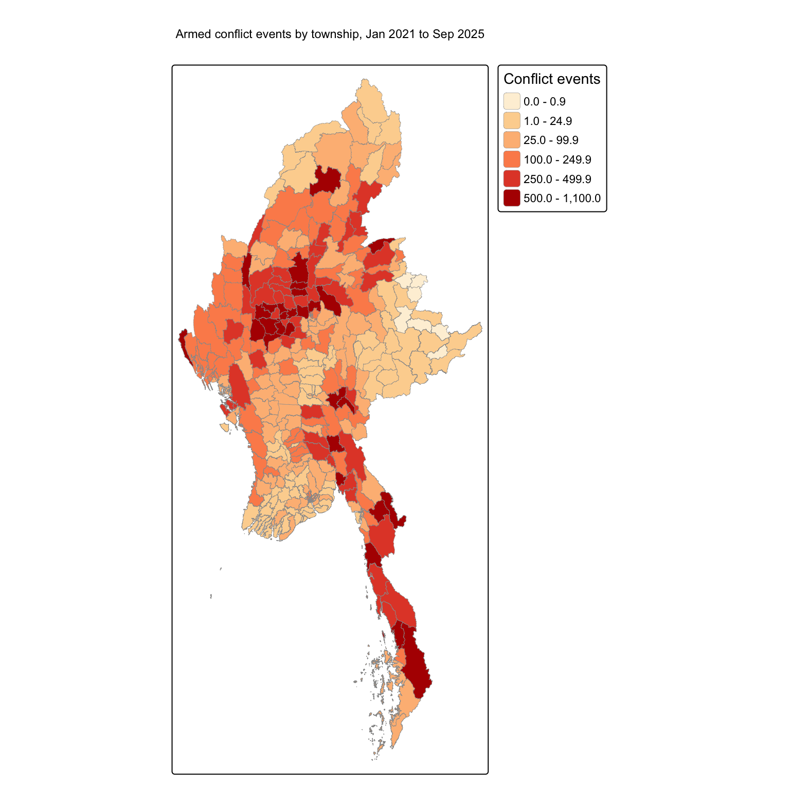
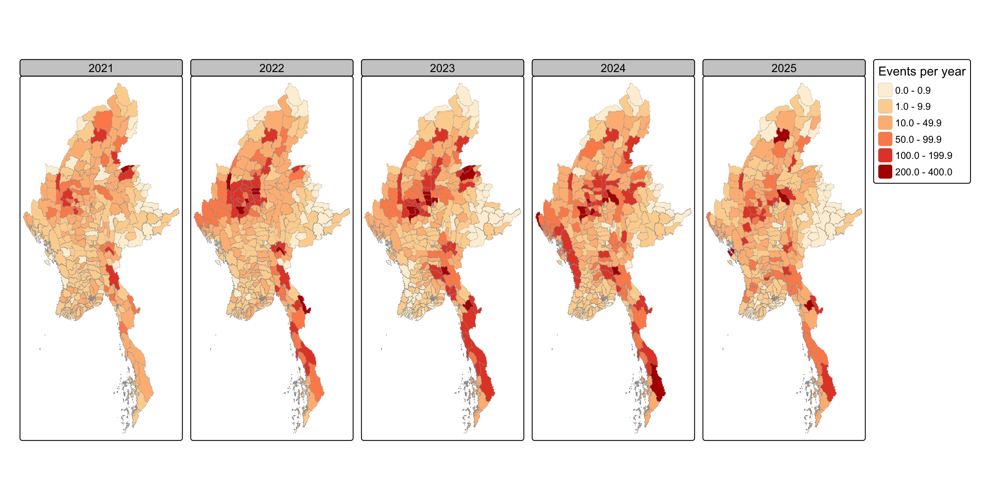
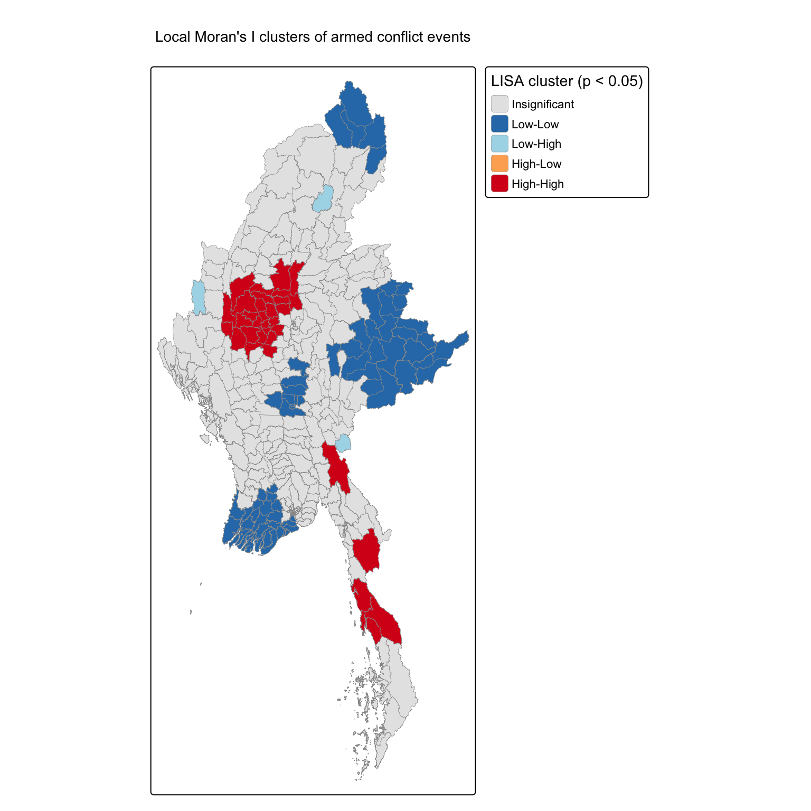
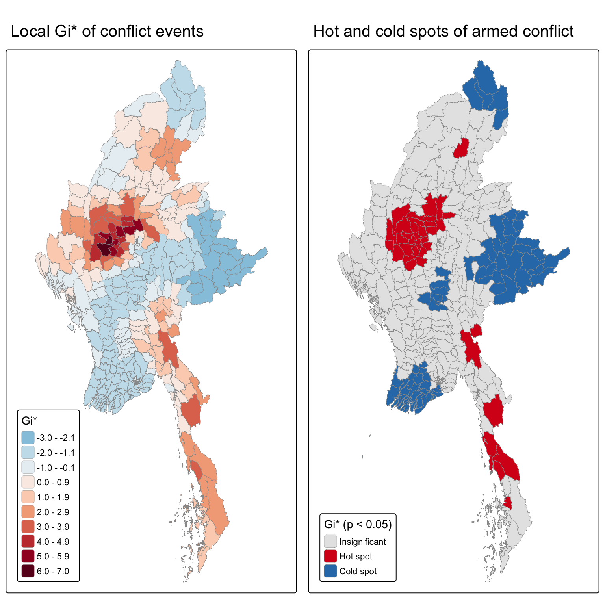
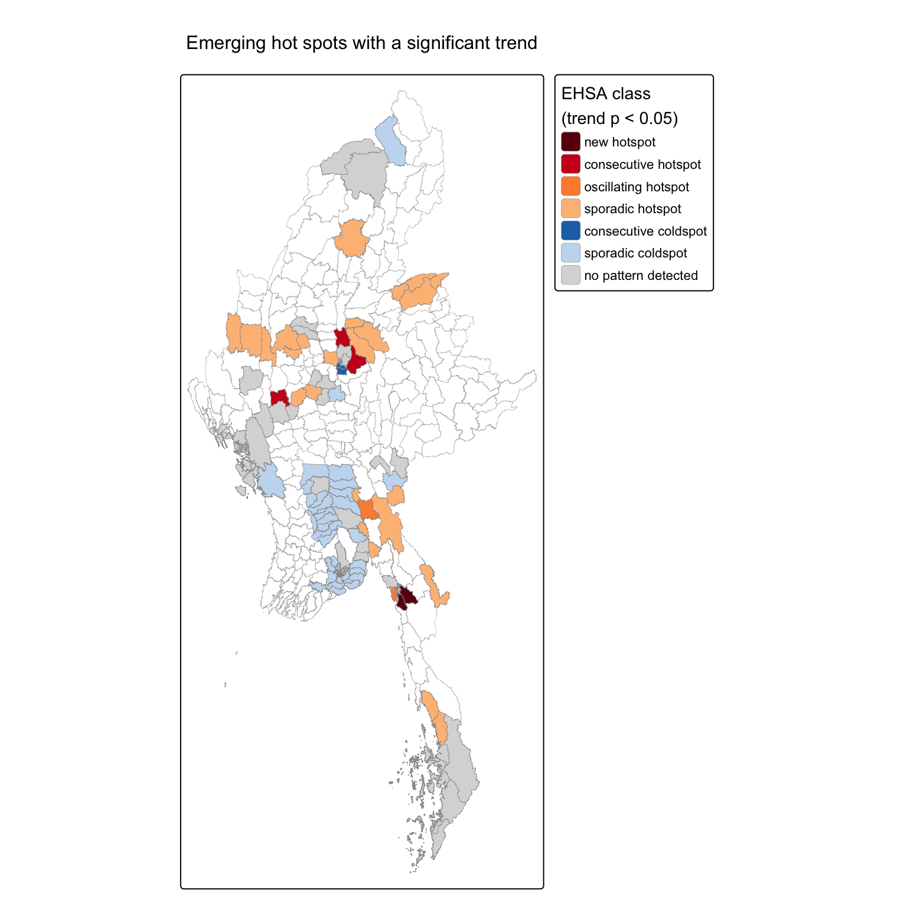
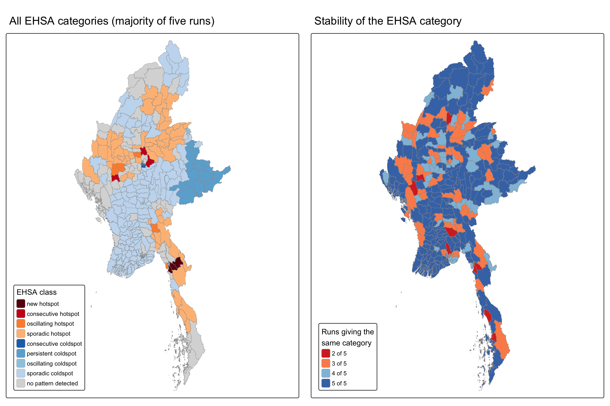
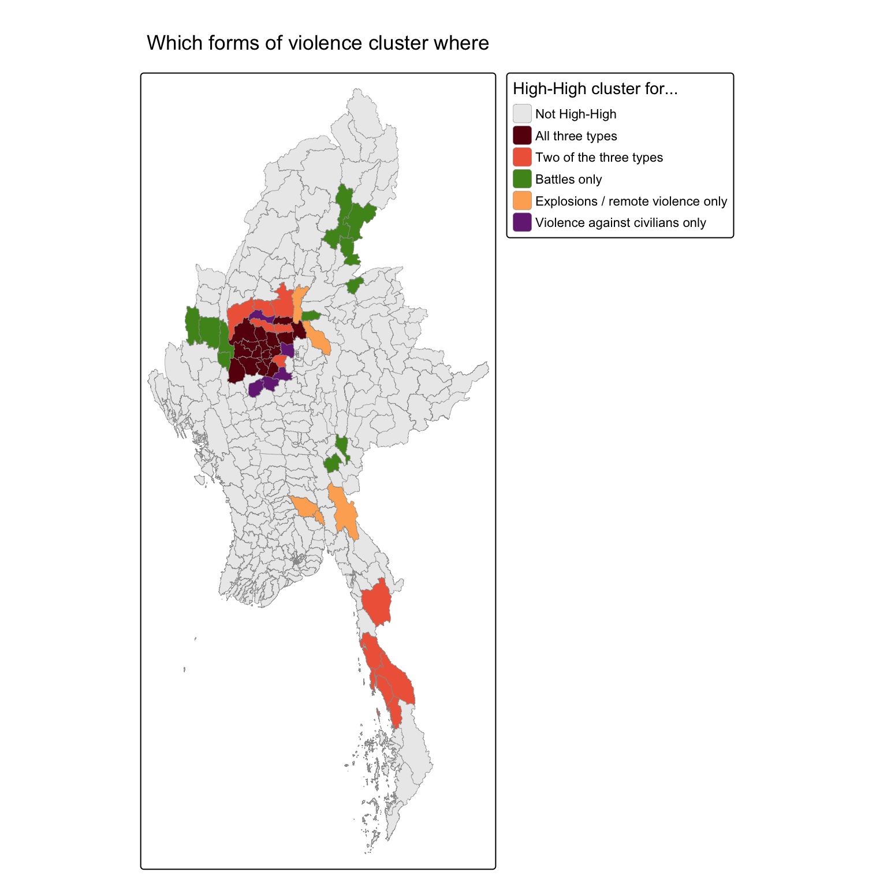

## Contents {.smaller}

1.  Research questions
2.  Data & study design
3.  Analytical approach
4.  Where and when conflict was recorded
5.  Local Moran's I clusters
6.  Gi\* hot and cold spots
7.  Emerging hot spots
8.  How stable are the EHSA labels?
9.  Value-added: three forms of violence
10. Findings, implications & limitations

## Research questions {.smaller}

:::::: columns
::: {.column width="55%"}
The coup of 1 February 2021 turned Myanmar's ethnic conflicts into a nationwide civil war. For humanitarian and peace-building actors the practical questions are:

-   **Q1:** Where is armed conflict concentrated across the 330 townships, and which townships stand out from their neighbours?
-   **Q2:** How have the hot and cold spots changed from 2021 to 2025?
-   **Q3 (value-added):** Do battles, remote violence and violence against civilians cluster in the same places?
:::

:::: {.column width="45%"}
{height="530" style="margin-top:-30px;"}

::: caption
Conflict events per township, Jan 2021 to Sep 2025.
:::
::::
::::::

## Data & study design {.smaller}

|  |  |
|------------------------------------|------------------------------------|
| **Events** | ACLED Myanmar, 1 Jan 2021 to 30 Sep 2025 |
| **Event types kept** | Battles; Explosions/Remote violence; Violence against civilians |
| **Cleaning** | 87,109 records → **53,907** conflict events (offshore and low-precision events removed) |
| **Boundaries** | MIMU v9.4 townships (330), projected to UTM 47N (EPSG:32647) |
| **Join** | spatial join on township code, not on names (99.0% agree with ACLED's own name) |
| **Space-time cube** | 330 townships × 19 quarters = 6,270 cells, empty cells filled with 0 |

::: {.callout-note appearance="minimal"}
A name join would fail on spelling differences, duplicate township names and 1,118 events with no township name. Locating each event inside a polygon avoids all three.
:::

## Analytical approach {.smaller}

Following r4gdsa, the analysis moves from the whole period to change over time:

| Question | Method | Setting |
|------------------------|------------------------|------------------------|
| Is conflict clustered at all? | **Global Moran's I** | 6 nearest neighbours, row-standardised |
| Which townships cluster or stand out? | **Local Moran's I** | 999 permutations, p \< 0.05 |
| Where are the hot and cold spots? | **Getis-Ord Gi\*** | sign of Gi\*, p \< 0.05 |
| How did each township change? | **EHSA** (Gi\* per quarter + Mann-Kendall) | 5 runs, majority category |
| Does each type of violence differ? | **LISA by event type** | same weights |

::: {.callout-note appearance="minimal"}
Nearest-neighbour weights are used because three island townships have no contiguity neighbours. The results hold for k = 4 to 10.
:::

## Where and when conflict was recorded {.smaller}

::::: columns
::: {.column width="58%"}

:::

::: {.column width="42%"}
*Each panel is one year. Darker townships recorded more events.*

-   **2021 to 2022:** violence spreads from the cities into the **Sagaing and Magway Dry Zone**. Sagaing alone holds a third of all events in 2022.
-   **Late 2023:** the national peak, driven by **Operation 1027** in northern Shan and the Arakan Army offensive in **Rakhine**.
-   **2024 to 2025:** the war is spread more widely, with more fighting in the **south-east**.
:::
:::::

## Local Moran's I: one large hot cluster {.smaller}

::::: columns
::: {.column width="55%"}
{height="530"}
:::

::: {.column width="45%"}
**Global Moran's I = 0.445** (p \< 0.001): townships with many events sit next to each other.

-   **34 High-High** townships, mostly in Sagaing, Magway and western Mandalay, with a smaller group in Kayin and Tanintharyi.
-   **74 Low-Low** townships in the Ayeyarwady delta, Yangon, Nay Pyi Taw, southern and eastern Shan.
-   **3 Low-High** outliers (Thantlang, Mogaung, Mese): quieter townships surrounded by heavy fighting.
:::
:::::

## Gi\* hot and cold spots {.smaller}

::::: columns
::: {.column width="55%"}
{height="530"}
:::

::: {.column width="45%"}
*Only townships with p \< 0.05 are coloured. Red is hot, blue is cold.*

**39 hot spots** and **75 cold spots**. The strongest hot spots are Salingyi, Myaing, Singu and Yesagyo, all in the Dry Zone.

Gi\* agrees with Local Moran's I. The Dry Zone is the centre of the war, and the delta, the big cities and the ceasefire areas of eastern Shan are cold.
:::
:::::

## Emerging hot spots: the war is moving {.smaller}

::::: columns
::: {.column width="55%"}
{height="530"}
:::

::: {.column width="45%"}
*Only townships with a significant Mann-Kendall trend (p \< 0.05) are coloured.*

-   **Dry Zone:** sporadic hot spots. Still the centre of the war, but **falling relative to the rest** of the country.
-   **New, consecutive and oscillating hot spots** in **Mon, Kayin, eastern Bago and northern Mandalay**: recent escalation.
-   **Yangon and Mandalay city:** consecutive cold spots that keep cooling.
-   **Rakhine:** "no pattern detected" but significant **rising trends**.
:::
:::::

## How stable are the EHSA labels? {.smaller}

::::: columns
::: {.column width="62%"}

:::

::: {.column width="38%"}
With 99 simulations the smallest p-value is 0.01, which is also the significance threshold. So EHSA was run **five times** and each township takes its most common category.

-   249 of 330 townships get the same label in at least 4 of 5 runs.
-   Large classes are stable; **new and consecutive hot spots are not**.

The regional message is reliable. Single township labels are indications.
:::
:::::

## Value-added: three forms of violence {.smaller}

::::: columns
::: {.column width="52%"}
{height="530"}
:::

::: {.column width="48%"}
**17 townships** are High-High for all three types: the shared Dry Zone core. Around it:

-   **Battles only:** Kachin, Kayah and Chin frontlines, where armed groups hold territory.
-   **Remote violence only:** eastern Bago, Hpapun, Thabeikkyin. Air strikes and shelling without matching ground clashes.
-   **Violence against civilians only:** Sagaing, Ye-U, Taungtha, Natogyi, Nyaung-U, on the edge of the battle area.
:::
:::::

## Findings, implications & limitations {.smaller}

::::: columns
::: {.column width="50%"}
**What the evidence supports**

-   Keep **sustained support** across the whole Dry Zone cluster, because violence moves between neighbouring townships.
-   Give **early attention** to the south-east, northern Mandalay and Rakhine, where escalation is recent.
-   Use **different tools** for different violence: ceasefire talks on battle frontlines, civilian protection where civilians are targeted.
:::

::: {.column width="50%"}
**Read with care**

-   ACLED records **reported** events; remote areas may be under-reported.
-   Raw counts favour large townships.
-   Gi\* trends are **relative** to each quarter's national picture.
-   Cold does not mean safe: eastern Shan is cold partly because of ceasefires.
-   The analysis shows **where and when**, not why.
:::
:::::
