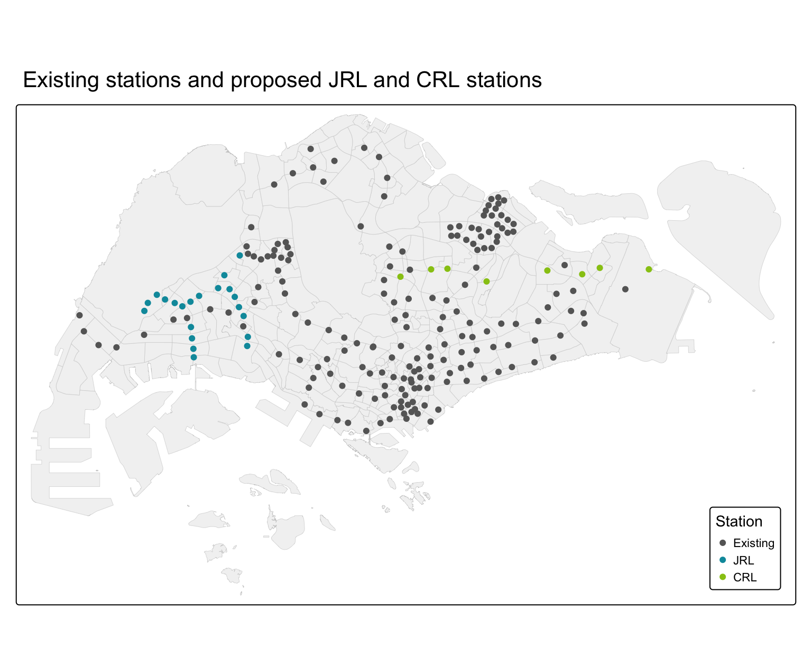
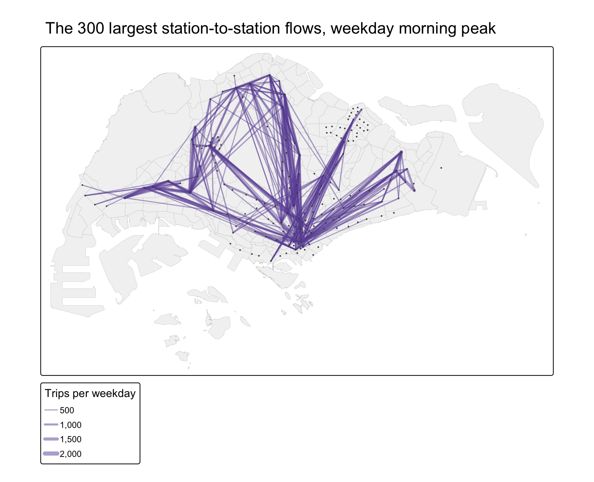
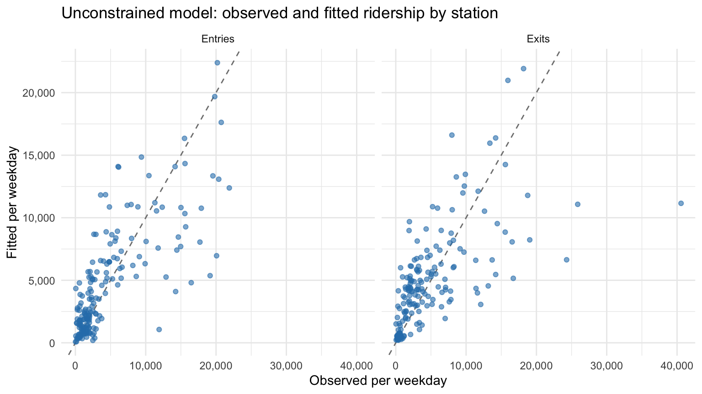
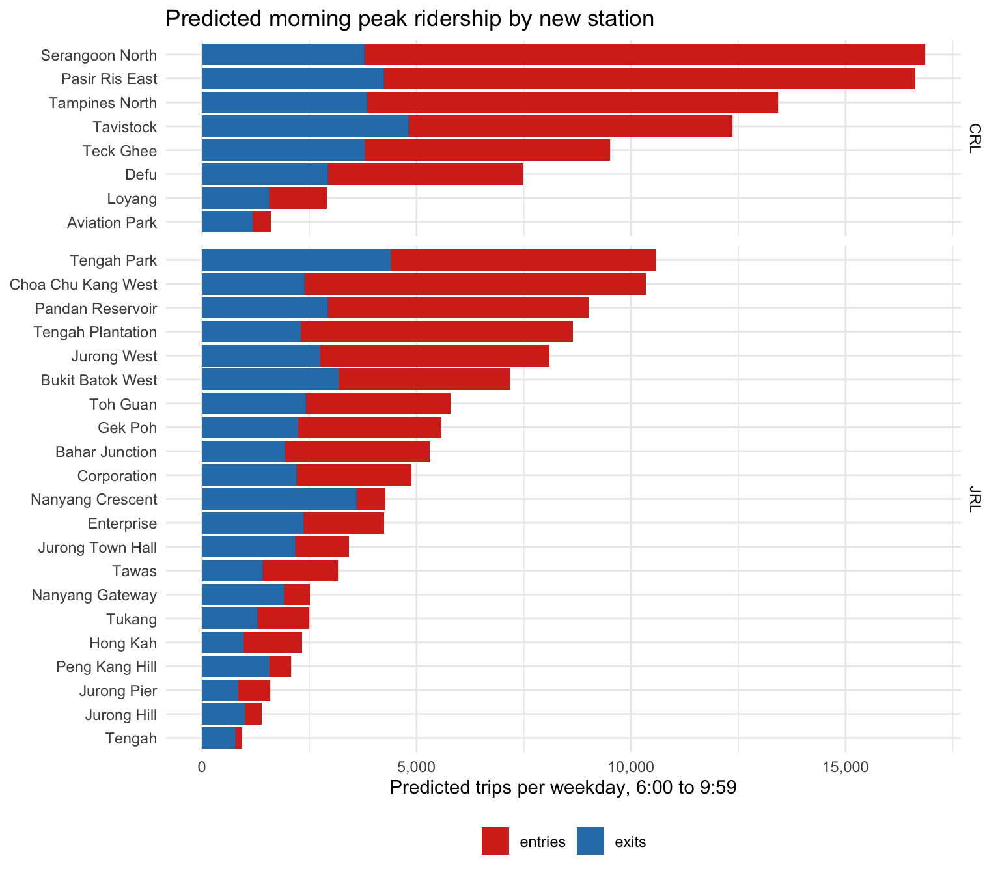
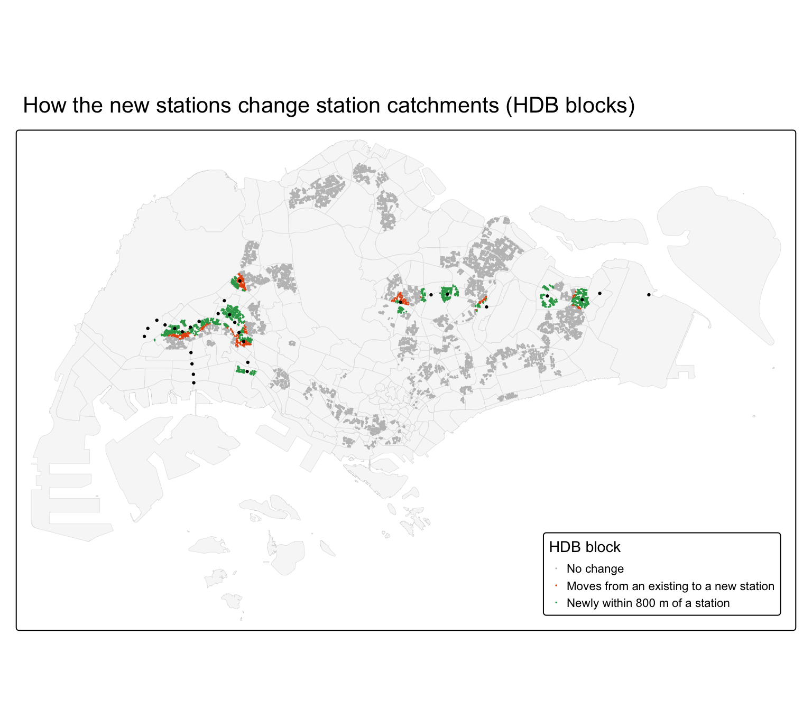
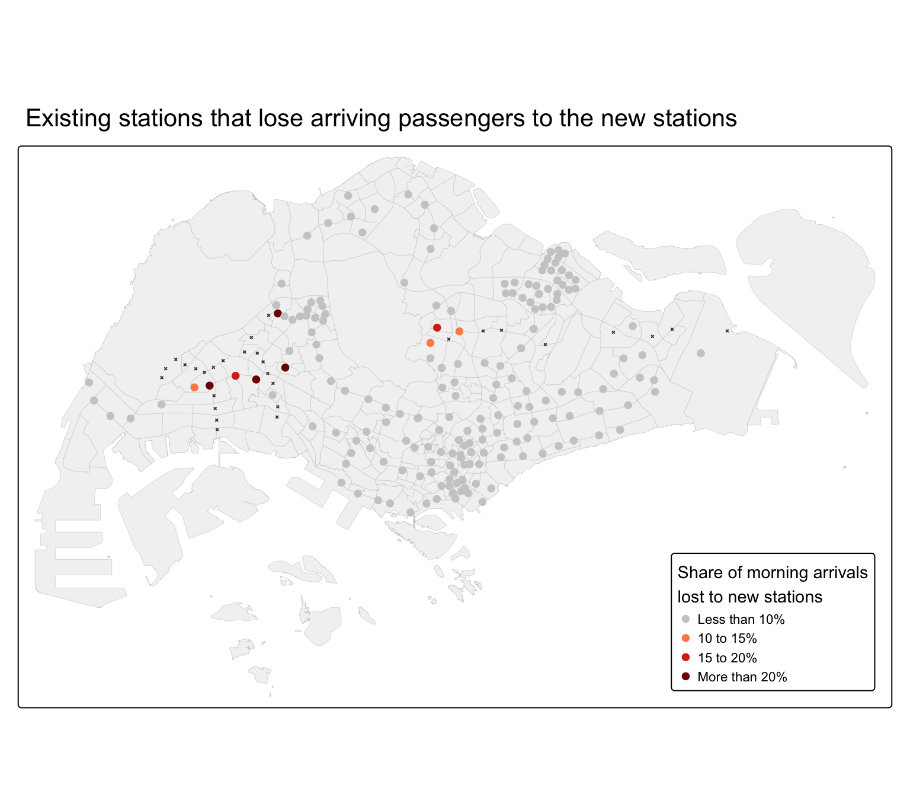
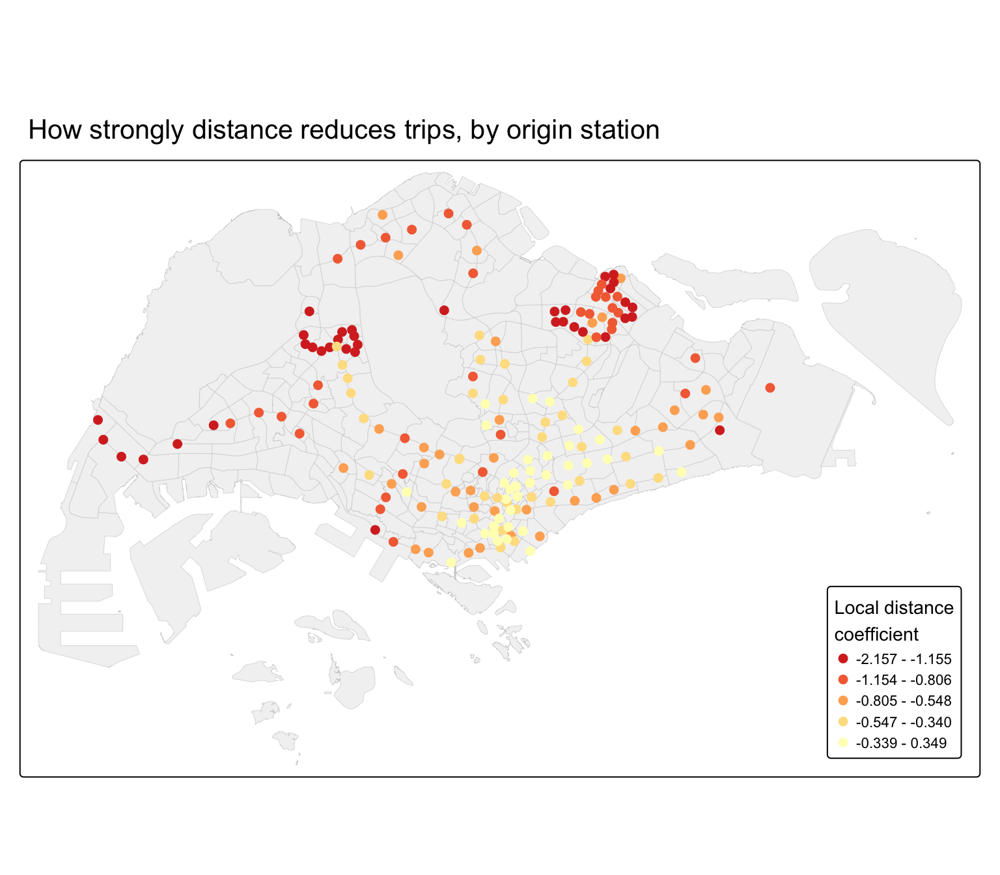

## Contents {.smaller}

1. Research question & study area
2. Data & study design
3. Analytical approach
4. Today's morning commute
5. Model calibration and reliability
6. Predicted ridership at the new stations
7. Impact 1: station catchments
8. Impact 2: competition for passengers
9. Value-added: local distance effects
10. Implications & limitations

## Research question & study area {.smaller}

::: {.columns}
::: {.column width="45%"}
Hume, Buangkok and Woodleigh were built but kept closed for years because too few passengers were expected. The Jurong Region Line (JRL) and Cross Island Line Phase 1 (CRL) will add **29 new stations** by 2030.

- **Q1:** How well do homes, activities and distance explain trips between stations?
- **Q2:** How many passengers will the new stations serve?
- **Q3:** Which existing stations will lose catchment or passengers?
- **Q4 (value-added):** Does distance matter the same everywhere?
:::
::: {.column width="55%"}

::: {.caption}
185 existing stations (grey), 21 new JRL stations and 8 new CRL stations.
:::
:::
:::

## Data & study design {.smaller}

| | |
|---|---|
| **Trips** | LTA DataMall, origin-destination train trips, weekdays 6:00 to 9:59, September 2026 (**864,000** per weekday) |
| **Stations** | LTA station polygons (existing); URA Master Plan 2019 rail station layer (new JRL and CRL stations) |
| **Origin potential** | HDB dwelling units within 800 m, from HDB building and property data (**99.3%** of units matched) |
| **Destination attraction** | OpenStreetMap shops, food and finance POIs; LTA bus stops |
| **Unit** | Ordered pair of stations: 185 × 184 = **34,040** pairs, distance in metres (EPSG:3414) |

::: {.callout-note appearance="minimal"}
Each home, POI and bus stop is assigned to its nearest station within 800 m, about a ten-minute walk. When a new station opens, the homes closer to it move to its catchment.
:::

## Analytical approach {.smaller}

Following r4gdsa Chapters 15 and 16, the spatial interaction models are Poisson regressions of station-to-station trips.

| Model | What it holds fixed | Used for |
|---|---|---|
| **Unconstrained** | nothing: attributes at both ends + distance | **Predicting new stations** (works without observed trips) |
| **Origin constrained** | trips leaving each station | **Market share impact** of new destinations |
| Destination constrained | trips arriving at each station | Comparison |
| Doubly constrained | both | Comparison (best fit) |

::: {.callout-note appearance="minimal"}
Constrained models give every station its own term, so they fit better but cannot predict a station that does not exist yet. That is why the unconstrained model is used for prediction.
:::

## Today's morning commute {.smaller}

::: {.columns}
::: {.column width="55%"}

:::
::: {.column width="45%"}
*Each line is one of the 300 largest station-to-station flows. Thicker lines carry more trips.*

- Trips **start** across the residential towns: Woodlands, Yishun, Sengkang, Punggol, Tampines, Boon Lay.
- Trips **end** in a few places, above all the **CBD** (Raffles Place, Tanjong Pagar, Outram Park) and **Jurong East**.
- So the model needs **homes at the origin**, **activities at the destination** and **distance**.
:::
:::

## Model calibration and reliability {.smaller}

::: {.columns}
::: {.column width="55%"}

:::
::: {.column width="45%"}
*Each dot is a station. Dots on the dashed line are estimated exactly.*

- More **homes** and **feeder bus stops** at the origin, more **shops and services** at the destination, and **interchanges** increase trips.
- **Doubling the distance** cuts trips by about **30% to 43%**.
- The unconstrained model explains **59%** of station entries and **44%** of exits.
- Tested on stations it has never seen, its error is **42%** for the median station: good for ranking stations, not for exact counts.
:::
:::

## Predicted ridership at the new stations {.smaller}

::: {.columns}
::: {.column width="55%"}
{height="530"}
:::
::: {.column width="45%"}
*Predicted trips per weekday, 6:00 to 9:59. Red bars are passengers entering, blue bars passengers leaving.*

- **Busiest:** CRL stations inside existing towns: **Serangoon North** (about 16,900), **Pasir Ris East** (16,600), **Tampines North** (13,400). On the JRL: **Tengah Park** and **Choa Chu Kang West** (about 10,500 each).
- **Quietest:** Tengah, Jurong Hill, Jurong Pier, Aviation Park, Peng Kang Hill, Hong Kah (under 2,500), with few homes within walking distance.
- Tengah is underestimated: its new blocks are not yet in the HDB data.
:::
:::

## Impact 1: station catchments {.smaller}

::: {.columns}
::: {.column width="55%"}
{style="margin-top:-45px; mix-blend-mode:multiply;"}
:::
::: {.column width="45%"}
*Each dot is an HDB block. Black dots are the new stations.*

- **Green:** about **107,900 homes** that are more than 800 m from any station today will be within walking distance of a new one. This is the new market of the two lines.
- **Orange:** about **33,800 homes** will move from an existing station to a closer new one.
- The largest losses are at **South View** (59% of its homes), **Boon Lay**, **Jurong East**, **Chinese Garden** and **Ang Mo Kio**.
:::
:::

## Impact 2: competition for passengers {.smaller}

::: {.columns}
::: {.column width="55%"}
{style="margin-top:-45px; mix-blend-mode:multiply;"}
:::
::: {.column width="45%"}
*Share of today's morning arrivals at each existing station that would go to a new station instead. Crosses mark the new stations.*

- Holding trips from each station fixed, the new stations would attract about **7%** of morning arrivals.
- Most stations lose under 10%, partly because a share model spreads some loss everywhere.
- Losses are clearly higher next to the new lines: **South View (32%)**, **Chinese Garden (25%)**, **Boon Lay (24%)**, **Bukit Batok (21%)**, Lakeside, Ang Mo Kio and Bright Hill.
:::
:::

## Value-added: does distance matter the same everywhere? {.smaller}

::: {.columns}
::: {.column width="55%"}
{style="margin-top:-45px; mix-blend-mode:multiply;"}
:::
::: {.column width="45%"}
*A separate distance coefficient is estimated for every origin station. Red means passengers are strongly put off by distance.*

- Coefficients range from **-2.2 to 0.3**, so one island-wide value hides real differences.
- **Steep (red):** the Bukit Panjang, Sengkang and Punggol LRT and the western East-West Line. Passengers here make short local trips.
- **Flat (yellow):** the city centre and the inner east.
- The JRL serves the west, where trips are local, so a single coefficient may underestimate its short trips.
:::
:::

## Implications & limitations {.smaller}

::: {.columns}
::: {.column width="50%"}
**What the evidence supports**

- **Open with full service** where demand is ready: Serangoon North, Pasir Ris East, Tampines North, Tengah Park, Choa Chu Kang West.
- **Watch list** for low ridership: Jurong Hill, Jurong Pier, Aviation Park, Peng Kang Hill, Hong Kah. Consider phased opening or lower initial frequency, as was done for Hume.
- **Redesign feeder buses** in Jurong West, Tengah and Tampines North around the new stations.
- Expect fewer morning passengers at **South View, Chinese Garden, Boon Lay and Bukit Batok**.
:::
::: {.column width="50%"}
**Read with care**

- Predictions have about **42%** error for a typical unseen station.
- Straight-line distance, not travel time.
- HDB homes only; POIs are a rough proxy for jobs.
- Tengah's new blocks are missing, so it is underestimated.
- One month, today's land use; the share model spreads some loss to every station.
:::
:::
